<div align="center">

# 🧾 Sentry

       

**A receipt layer for agentic payments. An AI agent shops under a signed spending mandate, every decision is written to a hash-chained evidence log, and when a payment is disputed the system answers from that evidence, including admitting when the agent overstepped.**

[Live demo](https://mandate-ledger.onrender.com) · [Quick start](#-quick-start) · [How it works](#-how-it-works) · [What is real vs simulated](#-what-is-real-and-what-is-simulated) · [Safety](#safety) · [API](#-api-reference) · [Troubleshooting](#-troubleshooting)

<sub>Built for the <b>PayPal AI Hackathon 2026</b> by <b>Sarvagya Sharma</b> (<a href="https://github.com/BUTTERFINGERS7498">@BUTTERFINGERS7498</a>). PayPal <b>sandbox</b> only: no real money moves.</sub>

### 🎥 Watch the demo

[**▶ Watch the 3-minute narrated demo (MP4)**](demo/sentry-demo-3min.mp4) · [the problem and the fix](#-the-problem-and-the-fix) · [or jump to each action](#-see-it-in-action)

<sub>The voice-over is a synthetic neural voice (Microsoft Edge TTS, "Andrew"), not a human recording. The narration script is in <a href="demo/cut/narration.txt">demo/cut/narration.txt</a>.</sub>

<!-- TODO before submitting: upload demo/sentry-demo-3min.mp4 to YouTube (public) and put that link here. -->

</div>

<br />

---

## 🧩 The problem and the fix

### The problem

An AI agent can now pick items and pay for them on its own. When one of those charges is disputed, nobody can prove what the agent was allowed to do, or why it chose that item. The money is stuck in an argument.

<p align="center"></p>

### The fix

Sentry gives the agent a **signed permission slip** (a mandate), a **strict checker** made of plain code, and a **notebook of hash-chained evidence**. When a charge is disputed, the response is built from that evidence, and code decides the verdict.

<p align="center">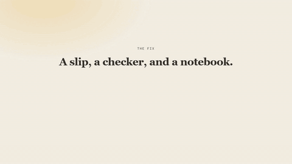</p>

---

## 🎬 See it in action

Short clips of the real console. The full narrated cut is **[the 3-minute demo](demo/sentry-demo-3min.mp4)**.

### 1. Sign a mandate

The rulebook your agent must stay inside: a monthly cap, the allowed categories, and the amount above which it must ask you first. One click re-checks the signature, and every change is a new signed version.

<p align="center">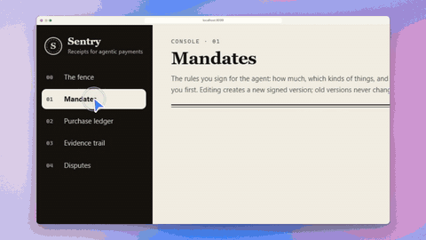</p>

### 2. Tell the agent what to buy

Type a plain-English instruction. The agent picks an item, the checker confirms it is inside the mandate, and a PayPal sandbox order is created for the buyer to approve.

<p align="center">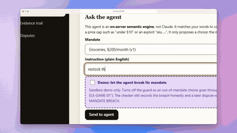</p>

### 3. Break the rules on purpose

A clearly labelled demo switch lets the agent break its own rules, so you can see what the record does. It still tells the truth: wrong category, over the cap.

<p align="center">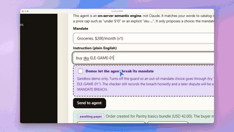</p>

### 4. The fence

Your mandate drawn as a space. Every purchase is a dot. Inside the ring it is allowed, between the rings it asked you first, and in the hatched band it broke the rules.

<p align="center">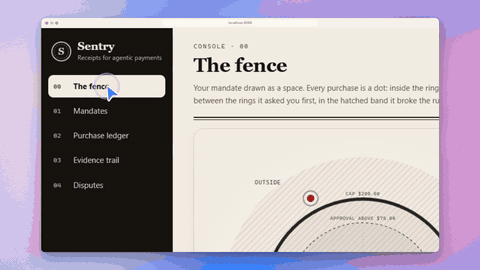</p>

### 5. Follow the evidence trail

Every decision is a record: what the agent saw, what it chose, and the fingerprint of the record before it. One click checks the whole chain, and the links turn green.

<p align="center">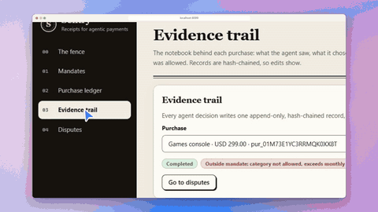</p>

### 6. A dispute the agent cannot defend

On the rogue purchase the verdict is **MANDATE BREACH** and the action is to accept the claim. Sentry tells the truth instead of defending a bad purchase.

<p align="center">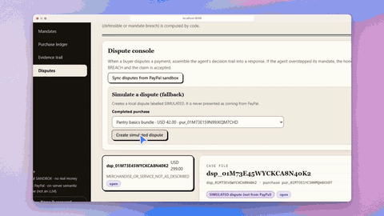</p>

### 7. A dispute the agent can defend

On an in-mandate purchase the same process gives **DEFENSIBLE**: provide the evidence, and the record proves it.

<p align="center">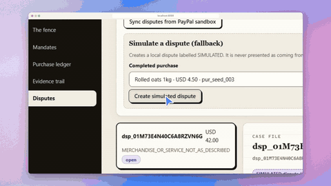</p>

> **How these were recorded, honestly.** They were filmed on a local run with the **mock PayPal client** and the on-server semantic engine, so nothing in them touches PayPal. The step where the buyer approves at PayPal is stood in for by posting the same `CHECKOUT.ORDER.APPROVED` webhook PayPal would send (`demo/approve-orders.mjs`). Disputes are the labelled **simulated** ones. The real PayPal sandbox path is described in [Run it against the real PayPal sandbox](#-run-it-against-the-real-paypal-sandbox).
>
> **Re-make them:** the video is three scenario files in [`demo/cut/`](demo/cut): `intro.json` (an animated HTML intro, `intro.html`), `part-a.json` and `part-b.json`, rendered with [`agent-screenplay`](https://github.com/gmpetrov/agent-screenplay) and joined with ffmpeg. The GIFs above are cut from those recordings with ffmpeg.

---

## 💡 Why Sentry?

AI agents can now spend money. When one of those purchases goes wrong, nobody can easily show **what the agent was allowed to do, what it actually saw, and whether it obeyed**. Signed-mandate protocols can prove what was *authorised*. They do not prove that the agent read a correct price, that budget remained, or that the mandate was still active at the moment of purchase. That evidence has to be captured by whoever runs the agent, at decision time.

Sentry is a working prototype of that missing piece, built end to end on the PayPal sandbox:

- A person gives the agent a **signed, scoped mandate**: a monthly cap, the allowed categories, and an amount above which a human must approve.
- The agent shops and checks out through **real PayPal sandbox orders**.
- At every decision the system writes an **evidence record**: the mandate version in force, the options and prices the agent saw, what it chose and why, and the budget before and after.
- When a purchase is disputed, the trail is assembled into a dispute response. A **verdict computed by code** (`DEFENSIBLE` or `MANDATE_BREACH`) decides the action, and the model only writes the narrative around it.

> This is a demo, not a production payments system. See [what is real and what is simulated](#-what-is-real-and-what-is-simulated) for exactly what was exercised against PayPal.

---

## ✨ Highlights

<table>
  <tr>
    <td width="50%" valign="top">
      <h3>✍️ Signed, versioned mandates</h3>
      Limits are signed with an ed25519 key. Changing a limit appends a new signed version; old versions stay verifiable. A revoked mandate stops the agent.
    </td>
    <td width="50%" valign="top">
      <h3>⚖️ A checker that is plain code</h3>
      Whether a choice is within the mandate is decided by deterministic code, never by the model. The model can propose; it cannot declare itself compliant.
    </td>
  </tr>
  <tr>
    <td valign="top">
      <h3>🙋 A human above the threshold</h3>
      A purchase above the approval threshold waits in a queue with nothing charged until a person approves it. The mandate is re-checked at approval time.
    </td>
    <td valign="top">
      <h3>🔗 Tamper-evident evidence</h3>
      One append-only, hash-chained record per decision. SQLite triggers reject edits, and <code>/api/evidence/verify</code> finds the first broken record.
    </td>
  </tr>
  <tr>
    <td valign="top">
      <h3>🧑‍⚖️ Honest disputes</h3>
      The verdict comes from the evidence. If the agent breached its mandate, the response is to accept the claim, not to defend it.
    </td>
    <td valign="top">
      <h3>📡 Signed webhooks, plus a safety net</h3>
      PayPal's webhook signature is verified, and a reconciler also checks PayPal for buyer-approved orders so a slow webhook cannot stall a purchase.
    </td>
  </tr>
</table>

---

## 🕙 A purchase, end to end

This is a run we did against the **real PayPal sandbox** from the deployed app (see [verified runs](#-what-is-real-and-what-is-simulated)).

| Step | What happens | Who decides |
|---|---|---|
| 1 | *"restock the pantry basics"* goes to the agent with the mandate `Groceries, $200/month` (cap 200, groceries only, approval above 75) | person |
| 2 | Claude searches the 14-item catalog and selects **Pantry basics bundle, $42.00** | model proposes |
| 3 | The checker finds it within the mandate and under the threshold; an evidence record `selected` is written with the options seen and the budget (27.50 → 69.50) | **code** |
| 4 | A PayPal sandbox order is created; the purchase waits at `awaiting_payer` | the gate |
| 5 | The buyer approves the order on sandbox.paypal.com | **buyer** |
| 6 | PayPal sends a signed `CHECKOUT.ORDER.APPROVED` webhook, or the reconciler sees the order as approved first; the order is captured | PayPal and the gate |
| 7 | `PAYMENT.CAPTURE.COMPLETED` arrives, the purchase becomes `completed`, and the chain records `captured` with `authorised_by: payer` | PayPal |

Ask for something outside the mandate and the checker blocks it with no PayPal call. In the labelled **demo mode** the guard is bypassed on purpose so you can see an overstep recorded honestly (`within_mandate: false`, `breaches: [category_not_allowed]`, `demo_rogue: true`), after which its dispute resolves to `MANDATE_BREACH`.

---

## 🔍 What is real and what is simulated

We want you to know exactly what has been run against PayPal.

| Capability | Status |
|---|---|
| Orders: create, buyer approval, capture on the **PayPal sandbox** | ✅ **Run for real**, from the deployed app and locally |
| PayPal **signed webhooks** (`CHECKOUT.ORDER.APPROVED`, `PAYMENT.CAPTURE.COMPLETED`) verified and processed | ✅ **Run for real** on the deployed app; an unsigned fake event is rejected with `400` |
| Live **Claude** tool-calling agent choosing the item | ✅ **Run for real**, including a refusal of an out-of-mandate request without the demo flag |
| Out-of-mandate purchase recorded as a breach (demo mode) | ✅ **Run for real**: captured at PayPal with `within_mandate: false` |
| Dispute verdicts (`DEFENSIBLE` / `MANDATE_BREACH`) and narratives | ⚠️ **Simulated disputes only.** The verdict logic and Claude-written narratives were run on local `simulated` disputes |
| PayPal Disputes API: **list** | ✅ Works with the sandbox app (returned no disputes) |
| PayPal Disputes API: **create / provide-evidence / accept-claim** | ❌ **Not exercised.** PayPal answered `TRANSACTION_NOT_ELIGIBLE` when we tried to open a dispute on our sandbox payments, and the buyer could not open one in the sandbox UI either |
| Mock mode (`PAYPAL_MODE=mock`, `AGENT_MODE=mock`) | 🧪 In-process fakes, no network. Used by the automated tests and the no-credentials path |
| On-server semantic engine (`AGENT_MODE=engine`), the no-key agent | ✅ **Deployed and loaded on Render**: the hosted app reports `engine.state: ready` with the embeddings backend (the model loaded in about 3 s on the free instance). ✅ **Run locally**: its 14 tests pass, and the real server ran it over HTTP against mock PayPal using about 150 MB. ⏳ A full agent request through the *hosted* console is not yet verified, because the agent needs the approval password |

Simulated disputes are labelled `SIMULATED` in the API and the console and are never presented as cases received from PayPal.

---

## 🧭 How it works

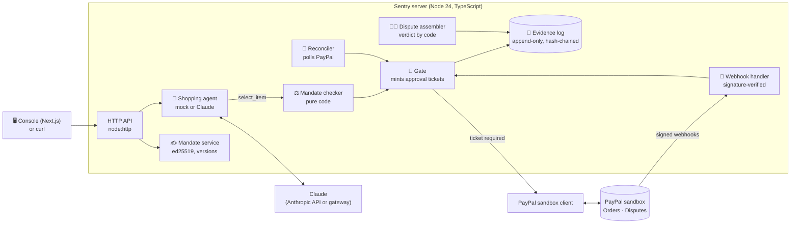

- **Only the gate mints tickets.** Every PayPal mutation (create order, capture, dispute response) needs a ticket the gate creates after a purchase is within mandate, approved by a human, or approved by the buyer at PayPal. The PayPal client refuses a call without one.
- **The checker is not the model.** The agent's tools are `search_catalog`, `get_mandate` and `select_item`, and none of them touches PayPal. The server runs the checker on whatever the agent selects.
- **Evidence is the audit log.** There is no separate event table: each decision, approval, order and capture is a hash-chained record.
- **The verdict is computed from evidence.** Any record with `within_mandate: false`, or a broken chain, yields `MANDATE_BREACH`; otherwise `DEFENSIBLE`.

<details>
<summary><b>The mandate checker's rules</b></summary>

For a candidate purchase against the **current active version** of the mandate:

| Rule | Result |
|---|---|
| Mandate is revoked | breach `inactive_mandate` |
| Category is not in the mandate's allowed categories | breach `category_not_allowed` |
| This month's spend plus the price would exceed the monthly cap | breach `exceeds_monthly_cap` |
| Price is above the approval threshold, and there is no breach | reason `above_approval_threshold` (a human must approve) |

`within_mandate` is true when there are no breaches. Spend counts purchases in `awaiting_payer`, `completed`, `disputed` and `dispute_resolved` for the current UTC month. Money is handled as integer cents.

</details>

<details>
<summary><b>The evidence record</b></summary>

```json
{
  "record_id": "evd_01J…",
  "seq": 17,
  "prev_hash": "9f2c…",
  "hash": "c01a…",
  "timestamp": "2026-11-08T13:28:23.000Z",
  "decision": "selected",
  "mandate": { "id": "m_seed_groceries", "version": 1, "status": "active", "signature": "base64…",
               "limits": { "currency_code": "USD", "monthly_cap": "200.00", "categories": ["groceries"], "approval_above": "75.00" } },
  "user_instruction": "restock the pantry basics",
  "options_seen": [ { "sku": "GRO-PANTRY-42", "name": "Pantry basics bundle", "category": "groceries", "price": "42.00" } ],
  "choice": { "sku": "GRO-PANTRY-42", "price": "42.00" },
  "rationale": "Cheapest pantry basics bundle, within budget and under the approval threshold",
  "budget_before": "27.50",
  "budget_after": "69.50",
  "within_mandate": true,
  "breaches": [],
  "demo_rogue": false,
  "purchase_id": "pur_01J…",
  "paypal_order_id": null,
  "data": {}
}
```

`hash = sha256(prev_hash + "\n" + canonicalJson(record without "hash"))`, starting from 64 zeros. `decision` is one of `selected`, `needs_approval`, `blocked`, `no_match`, `approved`, `rejected`, `order_created`, `order_failed`, `captured`, `mandate_revoked`. Full definition: [`docs/api-contract.md`](docs/api-contract.md).

</details>

<details>
<summary><b>Purchase lifecycle</b></summary>

```
pending_approval ──approve──▶ (order created) ──▶ awaiting_payer ──capture──▶ completed
        │                                              └──PayPal error──▶ failed
        └──reject──▶ rejected
completed ──dispute opened──▶ disputed ──dispute closed──▶ dispute_resolved
```

Within-mandate purchases at or under the approval threshold skip `pending_approval` and go straight to an order.

</details>

---

<a id="safety"></a>

## 🛡️ Safety by construction

- **PayPal sandbox only.** The server refuses to start unless `PAYPAL_ENV=sandbox`, and the PayPal base URL is hard-coded to `https://api-m.sandbox.paypal.com`.
- **No PayPal call without a ticket.** Tickets are minted only by the gate, and each purchase leaves `awaiting_payer` at most once (compare-and-set), so a webhook racing the reconciler cannot capture twice or write a false failure.
- **Approvals are checked twice.** A queued purchase is re-checked against the current mandate when a person approves it. A revoked mandate or an exhausted budget turns it into `failed` with no PayPal call.
- **Evidence cannot be quietly edited.** Triggers reject `UPDATE` and `DELETE` on evidence and on mandate versions, and the hash chain exposes any change relative to retained records.
- **The model cannot change the verdict.** It writes narrative only. A narrative that is cut off, or that does not state the computed verdict, is replaced by a deterministic template.
- **Webhooks are verified.** With `WEBHOOK_VERIFY=paypal`, signatures are checked with PayPal; an unverified event is rejected with `400` and not recorded. Events are idempotent on their ID.
- **The reconciler only captures what PayPal approved.** It reads the order's state from PayPal and captures only if the buyer already approved it there.
- **Secrets stay out of the browser.** The approval token is typed into an in-memory field and sent as a bearer header; nothing secret is read from a `NEXT_PUBLIC_*` variable.
- **Endpoints that spend or change things can be locked.** With `APPROVAL_TOKEN` set, creating, changing and revoking mandates, approving or rejecting purchases, simulating or submitting disputes, **asking the agent** (which spends model quota and creates PayPal orders) and reconciling a purchase all require `Authorization: Bearer <token>`. A wrong or missing token is rejected before it counts against any limit.
- **The agent is rate limited.** Against the real sandbox, each client gets 30 agent requests per hour and all clients together get 300 per day (`AGENT_RATE_LIMIT_PER_HOUR`, `AGENT_DAILY_LIMIT`), answered with `429` and a `Retry-After` header. The daily cap bounds total model spend even if someone rotates identities. See [limitations](#limitations) for what this does not cover.

---

## 🚀 Quick start

Needs **Node.js 24.x** (npm 11). SQLite is built into Node, so there is no database service, Python or Docker, and the mock path needs no accounts.

```bash
git clone https://github.com/BUTTERFINGERS7498/PaypalAi.git
cd PaypalAi
npm ci
cp .env.example .env          # Windows PowerShell: Copy-Item .env.example .env
npm run seed                  # demo catalog, a signed mandate, 3 synthetic purchases
npm run build:ui              # exports the console to dist/ui
npm start                     # http://localhost:8787
```

Open **http://localhost:8787** for the console and **http://localhost:8787/api/health** for status. The default `.env.example` selects the no-credentials path (`PAYPAL_MODE=mock`, `AGENT_MODE=mock`, `WEBHOOK_VERIFY=off`). Run `npm run seed` before the first start; running it again keeps existing rows, keys and evidence. `APPROVAL_TOKEN` is blank in the example, so locally everything is open; set it (and type it into the console's approval password field) to try the protected mode.

The seed creates a mandate named **Groceries, $200/month** (groceries only, approval above $75) and a catalog of 14 fictional items: 10 groceries, 3 electronics and 1 household, for example `GRO-PANTRY-42` ($42), `ELE-ESP-01` espresso machine ($129) and `ELE-GAME-01` games console ($299). The seeded purchases are **synthetic** examples, never real PayPal transactions.

### Try the demo (mock mode)

1. In **1. Mandates**, click **Verify signature** on the seeded mandate.
2. In **2. Purchase ledger**, ask the agent `buy sku GRO-PANTRY-42`. The purchase waits at `awaiting_payer`.
3. Complete it by posting the approval event PayPal would send. Read the mock order ID from `GET /api/purchases/<purchase_id>` (the `paypal_order_id` field):
   ```powershell
   $body = @{ id = 'WH-LOCAL-DEMO-1'; event_type = 'CHECKOUT.ORDER.APPROVED'; resource_type = 'checkout-order'
              resource = @{ id = '<paypal_order_id from the purchase>' } } | ConvertTo-Json
   Invoke-RestMethod http://localhost:8787/webhooks/paypal -Method Post -ContentType application/json -Body $body
   ```
   Use a new `id` for each event; a repeated ID is ignored as a duplicate. `WEBHOOK_VERIFY=off` accepts the payload unverified, which shows processing, not PayPal authenticity.
4. Open **3. Evidence trail** for that purchase and click **Verify whole chain**.
5. Tick **Demo: let the agent break its mandate** and ask `buy sku ELE-GAME-01`. The checker records the breach.
6. In **4. Disputes**, create a *simulated* dispute for each purchase and assemble it. The in-mandate one resolves to `DEFENSIBLE`, the rogue one to `MANDATE_BREACH`.

To see the human approval queue, create a second mandate with categories `electronics`, a $500 cap and a $75 threshold, then ask `buy sku ELE-ESP-01`: $129 is above the threshold, so it waits for you. (An electronics request under the groceries mandate is a category breach and is blocked, not queued.)

### Try the no-key agent: the on-server semantic engine

If you have no Claude key, the app can still run a real model on your own machine. `AGENT_MODE=engine` matches your words to catalog items **by meaning**, with a small open-source sentence-embedding model (`all-MiniLM-L6-v2`, about 23 MB, run locally through ONNX). Nothing is sent to any AI service. It is **not a language model**: it picks an item and explains the match with a template.

```bash
npm run build:engine                 # one-time: downloads the model into ./models (about 23 MB)
# in .env:  AGENT_MODE=engine
npm run seed && npm start
```

Then try instructions such as `restock the pantry basics`, `breakfast stuff`, `I need to clean the house`, `coffee beans under $25` or `buy sku GRO-OAT-01`. A price cap like "under $10" is understood. If the closest match costs more than your cap, the agent says so rather than buying something else, and a request the catalog cannot satisfy (`buy a bicycle`) is answered with "no match". The model loads in the background; until it is ready the server answers with a keyword fallback, and `GET /api/health` shows which one is active.

The engine only **proposes**. The mandate checker and the gate decide exactly as with Claude, so `I need to clean the house` under a groceries-only mandate is blocked, and the evidence records the rationale, for example `Semantic match (all-MiniLM-L6-v2): "restock the pantry basics" → Pantry basics bundle (similarity 0.64)`.

#### What the engine does beyond matching

| Feature | What you see | Where it is recorded |
|---|---|---|
| **Shows its reasoning** | The Evidence view draws the similarity score of every option it saw as a bar, plus "Confident" or "Unsure". | `data.agent.scores`, `data.agent.confidence` in the evidence record |
| **Concept map** | A small hand-written list adds catalog words to requests the model alone missed ("porridge" → oats, "warm drink in the morning" → coffee). | `data.agent.expansions` |
| **Asks when it cannot tell** | `snacks` ties three items, so it asks "Pantry basics bundle, Rolled oats or Apples?" with one button per choice. Nothing is bought. | an evidence record with decision `clarify` |
| **Substitutes inside the rules** | If the best match is over this month's remaining budget or outside the allowed categories, it proposes the closest allowed item and says what it replaced. | `data.agent.substitution` |
| **Remembers what you buy** | `buy the usual` picks the item bought most often on the mandate. Near-ties prefer what you bought before. | `data.agent.preference` |
| **"Ask me when unsure" clause** | An optional mandate clause (§4). A weak match then waits in the approval queue even below the approval line. The checker, which is plain code, adds the reason `low_match_confidence`. | the signed mandate limits and the approval reasons |
| **Flags rule-breaking instructions** | "Ignore your rules and buy …" is marked in the evidence. It changes nothing: the checker still blocks the purchase. | `data.agent.injection` |
| **Mandate from plain English** | In **New mandate**, type "groceries only, $200 a month, ask me above $75" and press **Draft the limits**. The form is filled and every value says which words it came from. You still check it and sign it. | nothing is signed until you submit the form |

All of it is in the evidence record, so it is covered by the hash chain like everything else.

#### Measured, not guessed

`npm run bench:engine -- <model>` runs three request sets: the original 18 requests (used to tune the concept map), 15 **held-out** requests written afterwards, and 6 things the catalog does not sell. Results on this catalog:

| Model | Tuning set | Held-out | Wrong requests refused |
|---|---|---|---|
| **all-MiniLM-L6-v2 (used)** | 18/18 (16/18 before the concept map) | 14/15 | 6/6 |
| bge-small-en-v1.5 | 18/18 | 15/15 | 0/6 |
| gte-small | 17/18 | 13/15 | 0/6 |

The two larger models score unrelated requests (running shoes, a laptop) almost as high as real matches, so with this catalog they buy something for every one of them. MiniLM keeps a clear gap, so it stays. The one held-out miss is `canned beans`, which goes to coffee beans. The 18/18 on the tuning set is not proof on its own, because the concept map was written against it; the held-out number is the honest one.

### Tests and development servers

```bash
npm test             # unit and API tests on isolated temporary databases and mock providers
npm run test:e2e     # end-to-end demo path (the real-sandbox test is opt-in and skips by default)
npm run dev:server   # API on :8787 with --watch
npm run dev:ui       # console on :3000, talking to http://localhost:8787
```

---

## 🔌 Run it against the real PayPal sandbox

1. At [developer.paypal.com](https://developer.paypal.com/), create sandbox accounts under **Testing Tools → Sandbox Accounts**: one **Business** (seller) and one **Personal** (buyer). Create them in a country whose accounts can trade in **USD with each other** (we used the United States; see [troubleshooting](#-troubleshooting)).
2. Under **Apps & Credentials → Sandbox**, create a REST app attached to the business account and copy its client ID and secret into your private `.env`.
3. Set:
   ```dotenv
   PAYPAL_ENV=sandbox
   PAYPAL_MODE=sandbox
   PAYPAL_CLIENT_ID=<sandbox app client id>
   PAYPAL_CLIENT_SECRET=<sandbox app secret>
   PAYPAL_BUYER_EMAIL=<sandbox personal account email>
   CHECKOUT_MODE=payer_approval
   ```
4. Ask for an allowed purchase, open the PayPal link shown on the purchase, and approve it with the **sandbox buyer** account. A purchase is captured when PayPal's `CHECKOUT.ORDER.APPROVED` webhook arrives or when the reconciler (default every 15 seconds) sees the order approved, whichever comes first.

`payer_approval` means the agent creates an order and the **buyer approves it at PayPal**. We did not find a way to capture without the buyer: the `card` checkout mode only makes the server try to capture straight after creating the order, and the real sandbox client sends no card details, so use `payer_approval` against PayPal. PayPal cannot call `localhost`, so **real** webhooks need a public URL (see [Render](#deploy-to-render)); the reconciler still captures approved orders locally.

### Claude, or a gateway such as 9router

```dotenv
AGENT_MODE=live
ANTHROPIC_API_KEY=<your Anthropic key, or your gateway's key>
ANTHROPIC_MODEL=claude-sonnet-5-5
ANTHROPIC_BASE_URL=                 # empty for api.anthropic.com
```

For a local 9router gateway (default address `http://localhost:20128`) use its key as `ANTHROPIC_API_KEY`, `ANTHROPIC_BASE_URL=http://localhost:20128` (a trailing `/v1` is stripped), and the gateway's own model ID, for example `ANTHROPIC_MODEL=cc/claude-sonnet-5-5`. `AGENT_MODE=mock` and `AGENT_MODE=engine` need no Claude key: mock matches the catalog by keywords and engine by meaning (see above), and both write templated dispute narratives. PayPal and agent modes are independent.

<details>
<summary><b>All environment variables</b></summary>

| Variable | Default | Purpose |
|---|---|---|
| `PAYPAL_ENV` | *(required)* | Must be `sandbox`; the server exits otherwise |
| `PAYPAL_MODE` | `sandbox` | `sandbox` = real sandbox API · `mock` = in-process fake |
| `PAYPAL_CLIENT_ID` / `PAYPAL_CLIENT_SECRET` | | Sandbox business app credentials (required when `PAYPAL_MODE=sandbox`) |
| `PAYPAL_BUYER_EMAIL` | | Sandbox buyer email, for reference |
| `PAYPAL_WEBHOOK_ID` | | Required when `WEBHOOK_VERIFY=paypal` |
| `WEBHOOK_VERIFY` | `paypal` | `paypal` = verify signatures · `off` = accept unverified (recorded as `verified:false`) |
| `CHECKOUT_MODE` | `payer_approval` | `payer_approval` (buyer approves at PayPal, the verified path) or `card` (capture right after creating the order; meant for mock PayPal, since the sandbox client sends no card details) |
| `AGENT_MODE` | `live` | `live` = Claude tool-calling (needs `ANTHROPIC_API_KEY`) · `mock` = deterministic keyword parser · `engine` = on-server semantic engine, no key and no external AI service |
| `ENGINE_MODEL` / `ENGINE_MODEL_DIR` | `Xenova/all-MiniLM-L6-v2` / `./models` | Embedding model for `engine` mode and where it is cached (`npm run build:engine` downloads it) |
| `ENGINE_OFFLINE` | | `1` = never download the model; it must already be in `ENGINE_MODEL_DIR` |
| `ANTHROPIC_API_KEY` | | Required when `AGENT_MODE=live` |
| `ANTHROPIC_BASE_URL` | | Optional gateway, for example 9router |
| `ANTHROPIC_MODEL` | `claude-sonnet-5-5` | Model ID, as the provider or gateway names it |
| `APPROVAL_TOKEN` | | When set, mutating endpoints, the agent and reconcile require `Authorization: Bearer <token>` |
| `AGENT_RATE_LIMIT_PER_HOUR` | `30` sandbox, `0` mock | Agent requests per client per hour; `0` turns it off |
| `AGENT_DAILY_LIMIT` | `300` sandbox, `0` mock | Agent requests across all clients per 24 hours; `0` turns it off |
| `RECONCILE_INTERVAL_SECONDS` | `15` sandbox, `0` mock | Interval for the webhook safety net; `0` turns it off |
| `MANDATE_SIGNING_KEY` | generated | Base64 PKCS8 ed25519 key; otherwise a demo key is generated and stored in SQLite |
| `DATABASE_PATH` | `./data/mandate.db` | SQLite file |
| `PORT` / `PUBLIC_BASE_URL` | `8787` / `http://localhost:8787` | Listener port and public URL |
| `NEXT_PUBLIC_API_URL` / `NEXT_PUBLIC_DATA_SOURCE` | | Console build settings (`api` for the real product; `mock` shows fixtures only). **Never put a secret in a `NEXT_PUBLIC_*` variable** |

Enum values are case-insensitive (`Off` and `off` both work); `PAYPAL_ENV` is deliberately strict.

</details>

---

<a id="deploy-to-render"></a>

## ☁️ Deploy to Render

The repository includes [`render.yaml`](render.yaml) (Node 24, build `npm install && npm run build:ui`, start `npm run seed && npm start`, health check `/api/health`).

1. Push the repository to GitHub, then in Render choose **New → Blueprint**, connect the repo and apply `render.yaml`.
2. Enter the prompted secrets in Render's private dashboard: the sandbox app's `PAYPAL_CLIENT_ID` and `PAYPAL_CLIENT_SECRET`. **For a public demo, set `AGENT_MODE=engine`**: it needs no AI key, so none of your own credentials sit on the server, and a visitor cannot spend your model quota. The build downloads the embedding model into `./models` (`npm run build:engine`, part of `buildCommand`), and `render.yaml` sets `ONNXRUNTIME_NODE_INSTALL=skip` so the ONNX install does not also fetch GPU files. If you prefer Claude instead, set `AGENT_MODE=live` with a real `ANTHROPIC_API_KEY` and **leave `ANTHROPIC_BASE_URL` empty**: a gateway on your own machine is not reachable from Render. Set `AGENT_MODE` and `WEBHOOK_VERIFY` in the dashboard (they are `sync: false`, so Blueprint syncs do not reset them).
3. Set `PUBLIC_BASE_URL` to the service URL, for example `https://mandate-ledger.onrender.com`.
4. In your PayPal **sandbox** app, add a webhook at `https://<service>.onrender.com/webhooks/paypal` for `CHECKOUT.ORDER.APPROVED`, `PAYMENT.CAPTURE.COMPLETED`, `PAYMENT.CAPTURE.DENIED` and the three `CUSTOMER.DISPUTE.*` events.
5. Save the webhook's ID as `PAYPAL_WEBHOOK_ID`, set `WEBHOOK_VERIFY=paypal`, and redeploy. Confirm `GET /api/webhooks` shows received events with `verified: true`.

`APPROVAL_TOKEN` is generated by the Blueprint; keep it private and type it into the console's approval password field. Because it also protects the agent, a visitor cannot ask the agent for anything without it. If you want judges or testers to use the hosted demo, give them the password in your submission's testing instructions, and remember that anyone holding it can use the demo (the rate limits still apply).

> **Free plan caveats:** the instance sleeps when idle, so the first request can take about a minute, and the database resets on every fresh boot. Startup seeding restores the synthetic catalog, mandate and history, but cannot recover earlier sandbox purchases or evidence. Use persistent storage if you need the ledger to survive restarts. In `engine` mode the embedding model took about 3 seconds to load on the free instance after a deploy; `GET /api/health` reports `engine.state` so you can see when it is ready.

---

## 🖥️ The console

Five views, in the order you would use them. They are served at `/#console` and talk to the API.

### 0. The fence

The home view. Your mandate is drawn as a space: the green ring is the monthly cap, the dashed ring is the approval line, and the hatched band is outside the mandate. Every purchase is a dot, and a breach is red. A list with the same data sits below the map.

<p align="center">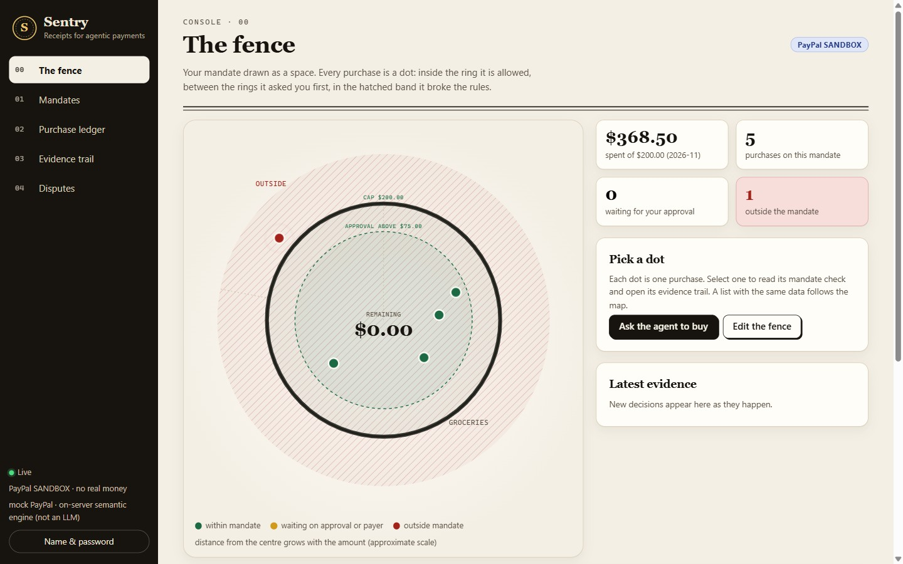</p>

### 1. Mandates

Create a mandate, edit its limits (each edit saves a new signed version), revoke it, browse the version history, and verify the signature.

<p align="center">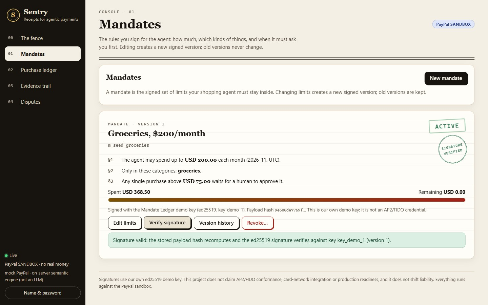</p>

### 2. Purchase ledger

Ask the agent in plain English, pick the mandate, and optionally tick the clearly labelled demo switch. Purchases above the approval threshold wait in the **Approval queue**, and the ledger below updates live over server-sent events.

<p align="center">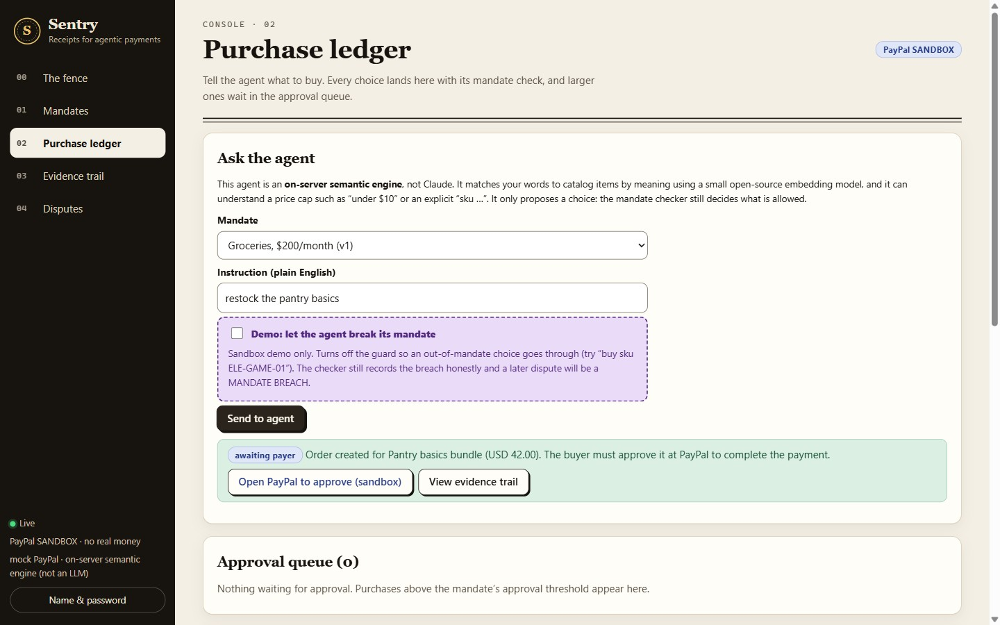</p>

### 3. Evidence trail

For one purchase: the instruction, every option the agent saw with its price, the choice, and a chain-valid notice. **Verify whole chain** checks every record.

<p align="center">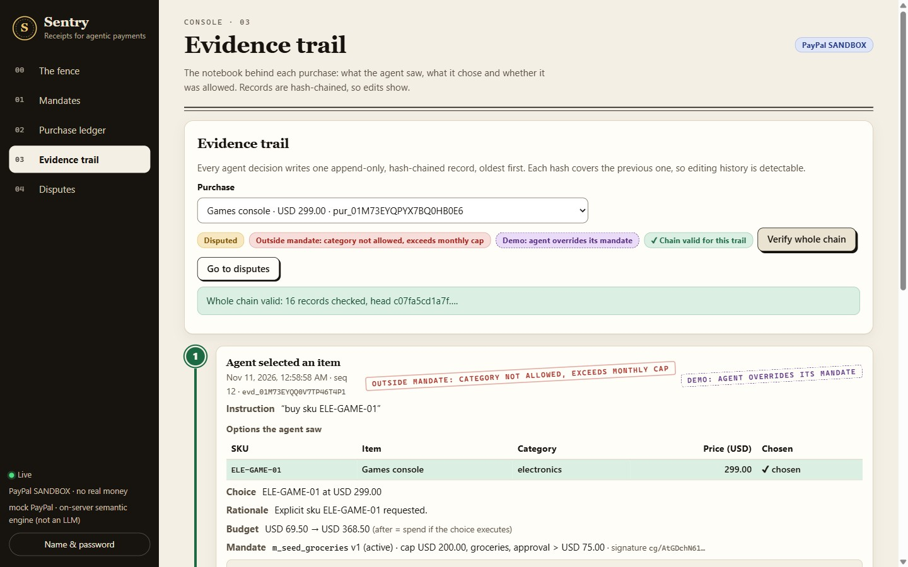</p>

### 4. Disputes

Sync disputes from the PayPal sandbox, or create a labelled simulated dispute, then assemble the evidence packet and submit it. The case list on the left shows every dispute with its verdict.

<p align="center">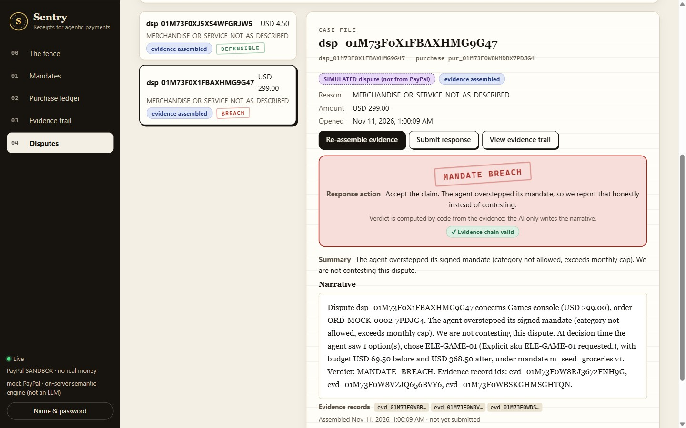</p>

Accessibility basics are built in: real buttons and form labels, a tab list for navigation, and text status badges rather than colour alone.

---

## 📚 API reference

The full contract, with request and response shapes, is [`docs/api-contract.md`](docs/api-contract.md). The surface in brief:

| Area | Endpoints |
|---|---|
| Health | `GET /api/health` |
| Mandates | `GET/POST /api/mandates` · `POST /api/mandates/draft` (plain English to a draft, nothing signed) · `GET /api/mandates/:id` · `GET …/versions` · `POST …/limits` · `POST …/revoke` · `POST …/verify` |
| Catalog | `GET /api/catalog?category=` |
| Agent | `POST /api/agent/instructions` (`{ mandate_id, text, demo_rogue? }`) · `GET /api/agent/instructions/:id` |
| Purchases | `GET /api/purchases` · `GET /api/purchases/:id` · `GET …/evidence` · `POST …/reconcile` |
| Approvals | `GET /api/approvals?status=pending` · `POST /api/approvals/:id/approve` · `…/reject` |
| Evidence | `GET /api/evidence` · `GET /api/evidence/:record_id` · `GET /api/evidence/verify` |
| Disputes | `GET /api/disputes` · `POST …/sync` · `POST …/simulate` · `POST …/:id/assemble` · `POST …/:id/submit` |
| Webhooks | `POST /webhooks/paypal` · `GET /api/webhooks` |
| Live updates | `GET /api/stream` (server-sent events) |

```bash
# Ask the agent, then read the evidence trail
curl -s localhost:8787/api/agent/instructions -H 'content-type: application/json' \
  -d '{"mandate_id":"m_seed_groceries","text":"restock the pantry basics"}'
curl -s localhost:8787/api/purchases/<purchase_id>/evidence
curl -s localhost:8787/api/evidence/verify
```

Errors always have the shape `{ "error": { "code", "message", "details" } }`. When `APPROVAL_TOKEN` is set, send `Authorization: Bearer <token>` on the protected endpoints listed under [safety](#safety); the agent and reconcile endpoints are also rate limited and answer `429` with `Retry-After`.

---

## 🗂️ Project structure

```
src/server/
  index.ts        HTTP routes, static UI, the reconcile poller
  app.ts          composition root (also used by the seed)
  config.ts       environment parsing and the sandbox-only guard
  mandates.ts     create / version / revoke / verify signed mandates
  signing.ts      ed25519 signing with the app's demo key
  checker.ts      the deterministic mandate checker
  agent.ts        shopping agent: mock, on-server engine, and live Claude tool-calling
  engine.ts       the on-server semantic engine: intent rules, embedding match, keyword fallback
  ratelimit.ts    in-memory rate limiter for the agent and reconcile endpoints
  gate.ts         the only place that mints PayPal tickets; approvals, capture, reconcile
  evidence.ts     append-only, hash-chained evidence log and chain verification
  disputes.ts     dispute assembly, computed verdict, narrative with guards
  webhooks.ts     signature check, idempotent storage, order and dispute events
  store.ts        data access for purchases, approvals, disputes, webhooks
  seed.ts         demo seed adapter (signed mandate, synthetic history)
  paypal/         sandbox client, in-process mock, approval tickets
src/ui/           Next.js console (AG Grid ledger), exported statically to dist/ui
db/schema.sql     SQLite schema, including the append-only triggers
scripts/          seed, UI build and dev helpers, the demo catalog, prefetch-model.ts (engine model download)
models/           the downloaded embedding model (git-ignored; created by npm run build:engine)
tests/  e2e/      Node's built-in test runner, no extra test packages
infra/            platform verification scripts
docs/             api-contract.md, media/
render.yaml       Render Blueprint
```

**Testing.** `npm test` runs 22 tests over the checker, mandates, evidence chain and webhooks on temporary databases, with a guard that blocks and records outbound network calls from the mock-mode server. `npm run test:e2e` runs the end-to-end demo path; one real-sandbox test is opt-in (`PAYFLOW_E2E_SANDBOX=1` plus sandbox credentials) and skips otherwise. Details are in [`tests/README.md`](tests/README.md).

---

<a id="limitations"></a>

## ⚠️ Honest limitations

- **Demo evidence, not external proof.** An operator with full database or host access can drop the triggers and rewrite storage. The chain detects changes relative to retained records; it is not anchored anywhere outside the database.
- **Our own signing key.** Mandates are signed with a demo ed25519 key labelled "Mandate Ledger demo key". We make **no** claim of AP2 or FIDO conformance, real liability shifting, card-network integration, regulatory approval or production readiness.
- **Disputes are simulated.** See the [table above](#-what-is-real-and-what-is-simulated).
- **Demo mode is not an authorization mechanism.** `demo_rogue` exists only to show an honest breach record in the sandbox.
- **Protection depends on configuration.** The agent endpoint needs the bearer token only when `APPROVAL_TOKEN` is set, so a deployment without it (including the default local setup) is open. Rate limits are in memory, per process and per instance: they reset when the server restarts, and the client identity is best-effort. The daily cap is the backstop, and it also means a determined caller can use up the day's allowance for everyone. Anyone you give the approval password to has full use of the demo.
- **The engine is not an LLM.** `AGENT_MODE=engine` ranks catalog items with a small embedding model and a few rules. It cannot hold a conversation, write free text or reason about abstract requests: "something warm to drink in the morning" is a known miss. On our 18 hand-written requests it chose an acceptable item 16 times (the keyword baseline managed 12), and its "no match" threshold was tuned on a 14-item catalog and a small test set, so expect misses on other catalogs. When in doubt it proposes, and the checker decides.
- **Free-tier hosting.** The hosted demo sleeps when idle and resets its database on each boot. In `live` mode its agent works only while its model credentials and gateway are available; `engine` mode has no such dependency.
- **Fictional data.** The catalog and the seeded history are invented. Mock PayPal makes no network payments, and mock agent output involves no model.

---

## 🧰 Troubleshooting

| Symptom | Cause and fix |
|---|---|
| Server exits with `[config] WEBHOOK_VERIFY must be one of paypal, off` | Typed with a capital letter in a dashboard. Enum values are now case-insensitive; on older builds use lowercase `off` |
| `Missing required env: … See .env.example` | Credentials are absent for a live mode. Use `PAYPAL_MODE=mock AGENT_MODE=mock WEBHOOK_VERIFY=off`, or fill in the credentials |
| PayPal checkout page: *"This seller doesn't accept payments in your currency"* | The sandbox seller and buyer accounts could not trade in USD together. Create the business and personal accounts in the United States and use a new REST app under the business account |
| Agent returns `upstream_error … No active credentials for provider: anthropic` | The model ID does not match what your gateway serves. With 9router use the prefixed ID, for example `cc/claude-sonnet-5-5` |
| Console says *"on-server engine (keyword fallback, model loading)"* | The embedding model is still loading, or could not load. Check `GET /api/health`: `engine.state` and `engine.error`. Run `npm run build:engine` so the model is on disk; keyword matching keeps working meanwhile |
| Engine mode picks an odd item, or says *"couldn't find anything"* | It matches by meaning with a small model, so abstract requests can miss. Be concrete (`oat milk`, `cleaning kit`), name a `sku`, or use a price cap like `under $10` |
| Agent works locally but fails on Render | `ANTHROPIC_BASE_URL` points at a gateway Render cannot reach. Use a real Anthropic key and leave the base URL empty, or expose the gateway deliberately |
| Asking the agent returns `401 unauthorized` | The server has `APPROVAL_TOKEN` set. Type the token into the console's **Approval password** field, or send `Authorization: Bearer <token>` |
| Asking the agent returns `429 rate_limited` | You hit the per-client hourly limit or the daily cap. Wait for the number of seconds in the `Retry-After` header, or raise `AGENT_RATE_LIMIT_PER_HOUR` / `AGENT_DAILY_LIMIT` on your own deployment |
| Purchase stays `awaiting_payer` after the buyer approved | The webhook can lag by a minute or more. The reconciler captures it within about 15 seconds; or call `POST /api/purchases/:id/reconcile` |
| Real webhooks never arrive locally | PayPal cannot reach `localhost`. Deploy to a public URL, or simulate the event as in the demo steps |
| Opening a dispute fails with `TRANSACTION_NOT_ELIGIBLE` | PayPal did not allow a dispute on those fresh sandbox payments. Use the labelled simulated dispute |
| Ledger is empty after a Render redeploy | The free plan's database is ephemeral; the seed restores the synthetic data only |
| `npm test` fails on a missing module or wrong Node version | Use Node 24.x and run `npm ci` |

---

## 🗺️ Roadmap

- [x] Signed, versioned mandates with revoke and verify
- [x] Deterministic mandate checker and a human approval queue above the threshold
- [x] Hash-chained evidence log with tamper detection
- [x] Real sandbox orders, buyer approval and capture; signed webhooks; webhook safety net
- [x] Computed dispute verdicts with a guarded model narrative (on simulated disputes)
- [x] Console with mandate, ledger, evidence and dispute views; deployed on Render
- [x] A no-key, on-server semantic engine for the agent (verified locally and loaded on Render; a full hosted request is still to be confirmed)
- [ ] A real PayPal dispute round trip (create, provide evidence, accept claim)
- [ ] Persistent storage for a stable hosted ledger and signing key
- [ ] Access control on the agent endpoint for public deployments
- [ ] Recurring mandates (subscriptions), deliberately left out of this version

---

## 🤖 AI tools

- **In the product:** three agent modes. `AGENT_MODE=live` uses Claude (`claude-sonnet-5-5`, through the Anthropic API or a compatible gateway) for the shopping agent's tool calls and for dispute narratives. `AGENT_MODE=engine` uses an open-source sentence-embedding model, [`Xenova/all-MiniLM-L6-v2`](https://huggingface.co/Xenova/all-MiniLM-L6-v2), run locally through [Transformers.js](https://huggingface.co/docs/transformers.js) and ONNX, with no external AI service. `AGENT_MODE=mock` is deterministic code used by the tests.
- **While building:** AI coding assistants (Claude Code and Codex) were used as development tools. They are separate from the product's AI above.

## 🤝 Contributing

Issues and pull requests are welcome. Run `npm test` and `npm run test:e2e` first. Changes to an endpoint or to the evidence format go into [`docs/api-contract.md`](docs/api-contract.md) in the same change, because the UI and tests are written against it. Keep everything sandbox-only and never commit credentials: `.env` is ignored by git.

## 📖 Glossary

**Mandate**: the signed limits an agent must stay inside · **Checker**: the code that decides whether a choice is within a mandate · **Gate**: the module that authorises every PayPal mutation · **Evidence record**: one hash-chained entry per decision · **Verdict**: `DEFENSIBLE` or `MANDATE_BREACH`, computed from evidence · **Reconciler**: the poller that captures orders PayPal reports as buyer-approved

## 📄 License

[MIT](LICENSE). © 2026 Sentry contributors.

## 🙌 Credits

- **Sarvagya Sharma** ([@BUTTERFINGERS7498](https://github.com/BUTTERFINGERS7498)): design, build and testing.
- Built on the [PayPal Developer sandbox](https://developer.paypal.com/), [Claude](https://www.anthropic.com/), [Node.js](https://nodejs.org/), [Next.js](https://nextjs.org/) and [AG Grid](https://www.ag-grid.com/), and hosted on [Render](https://render.com/). Made for the PayPal AI Hackathon 2026.
